<div align="center">

<a href="https://git.io/typing-svg"></a>

<a href="https://www.datascienceportfol.io/ArpitKumar"></a>
<a href="https://www.linkedin.com/in/arpit-kumar-261888315/"></a>


</div>

 whoami"/>

```python
class ArpitKumar:
    def __init__(self):
        self.role         = "Data Analyst  →  ML / GenAI Engineer (in training)"
        self.education    = "B.Tech CSE @ Bennett University"
        self.selected_for = "Amazon ML Summer School 2026 🎓"
        self.daily_stack  = ["SQL", "Python", "Power BI"]
        self.learning     = ["Machine Learning", "Generative AI", "Agentic AI", "Data Engineering"]
        self.philosophy   = "Find the story hiding inside messy data."

    def open_to(self):
        return ["Data Analytics", "AI/ML", "Python projects", "Open source"]

    def ask_me_about(self):
        return ["Turning ambiguous data into a clear recommendation",
                "Debugging a SQL query at 2 AM ☕"]

    def fun_fact(self):
        return "I use auction-strategy analytics on my actual IPL fantasy drafts 🏏"

me = ArpitKumar()
```

 ls ~/tech-stack"/>

<div align="center">


<br/><br/>


</div>

 cat ./featured_projects.log"/>

<p align="center">
  <a href="https://github.com/arpit-k16/IPL-Sports-Analytics-Auction-Strategy"></a>
  <a href="https://github.com/arpit-k16/Optimizing-Airline-Loyalty-Retention-Using-Customer-Analytics-ML"></a>
  
</p>

 git log --achievements"/>

<p align="center"></p>

 ./github_stats.sh --live"/>

<div align="center">


</div>

 render --3d ./contributions"/>

<p align="center">
  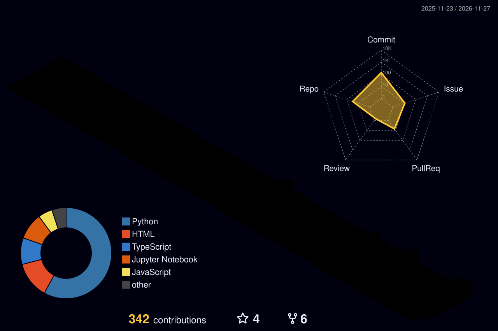
</p>

<p align="center">
  <picture>
    <source media="(prefers-color-scheme: dark)" srcset="https://raw.githubusercontent.com/arpit-k16/arpit-k16/output/github-snake-dark.svg" />
    <source media="(prefers-color-scheme: light)" srcset="https://raw.githubusercontent.com/arpit-k16/arpit-k16/output/github-snake.svg" />
    
  </picture>
</p>

 ping arpit --connect"/>

<div align="center">

<a href="https://www.linkedin.com/in/arpit-kumar-261888315/"></a>
<a href="https://www.datascienceportfol.io/ArpitKumar"></a>
<a href="https://github.com/arpit-k16"></a>

<br/><br/>

<code>"Turning data into insights, ideas into projects, and bugs into learning opportunities." 🚀</code>

</div>


